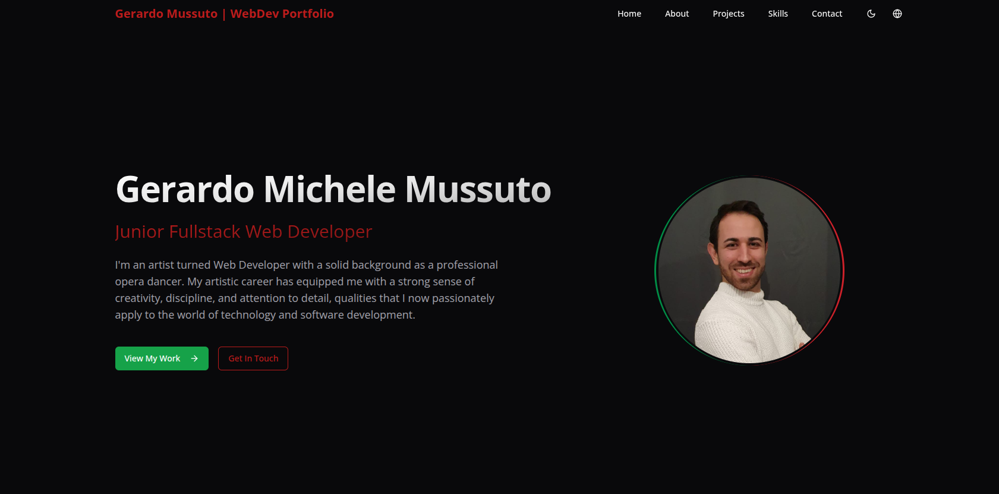
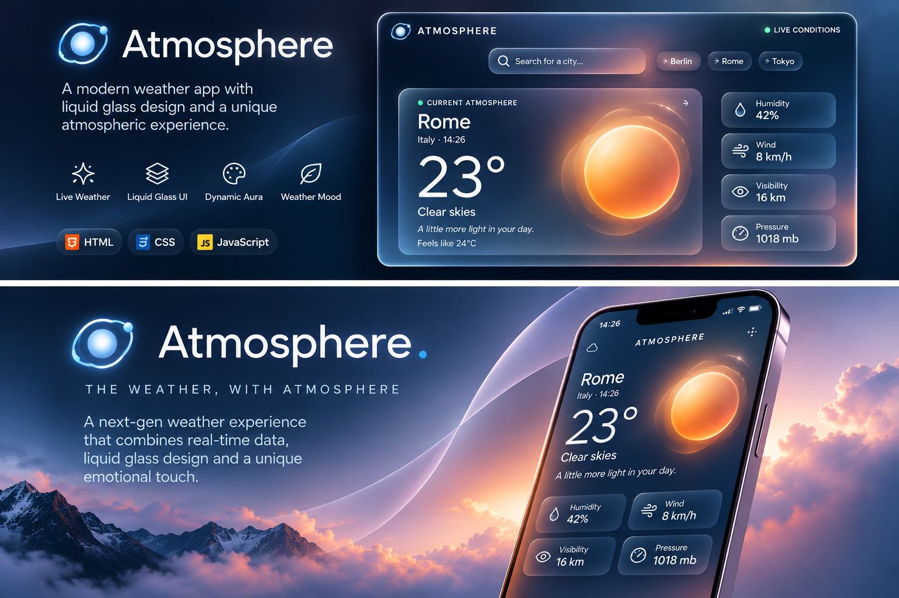

# Hi, I'm Gerardo Michele Mussuto 👋

### Full Stack Developer | Exploring AI Engineering & Automation

📍 Berlin, Germany · 🇮🇹 Italian · 🌍 English · 🇩🇪 German (B1)

**I build practical web applications and automations with a focus on usability, problem-solving, and real-world impact.**

## About me

I'm a Berlin-based developer with training in full-stack web development and hands-on experience building React applications, Node.js APIs, real-time communication features, and workflow automations.

Before moving into technology, I spent years working professionally in opera and ballet. That background shaped how I collaborate, communicate, and pay attention to detail. Today, I'm building on my software engineering foundation while exploring **AI engineering, cloud services, and practical automation**.

- 🔭 **Focus:** Full-stack development, AI-powered applications, and automation
- 🧩 **Experience with:** React, TypeScript, JavaScript, Node.js, Express, MongoDB, C# / ASP.NET MVC
- ☁️ **Learning and practice:** Microsoft Azure AI & machine learning workflows
- 🎓 **Certification:** Microsoft Azure AI Fundamentals (AI-900)
- 🤝 **Open to:** Development, application support, technical support, and AI/automation opportunities in Berlin or remote-friendly teams

## Technical skills

| Area | Technologies |
| --- | --- |
| **Frontend** | JavaScript, TypeScript, React, HTML5, CSS3, SCSS, Tailwind CSS, Bootstrap, Vite |
| **Backend & APIs** | Node.js, Express, REST APIs, Socket.IO, C#, ASP.NET MVC |
| **Data & databases** | MongoDB, SQL fundamentals |
| **Cloud & automation** | Microsoft Azure (learning projects), n8n, Google Sheets integrations |
| **Developer tools** | Git, GitHub, VS Code, Visual Studio, Postman |

## Featured projects

These projects show how I approach product development, real-time applications, API integrations, and automation.

### 💬 CodeSquareChat — real-time messaging application

A full-stack team project featuring chat rooms, private messaging, user authentication, and profile management. Built with a React frontend and a Node.js / Express backend, with Socket.IO for real-time communication.

**Stack:** React · TypeScript · Vite · SCSS · Node.js · Express · Socket.IO · MongoDB · JWT

[Frontend repository](https://github.com/Onid89/csc-frontend) · [Backend repository](https://github.com/Onid89/csc-backend)

### ⚙️ Job Application Tracker — n8n workflow automation

An automation workflow designed to make job-application tracking more efficient. It collects form submissions, stores them in Google Sheets, sends confirmation emails, and triggers follow-up reminders.

**Stack:** n8n · Google Sheets · Gmail · Workflow automation

[View repository and screenshots](https://github.com/Onid89/n8n-job-application-tracker)

### 🌐 Personal Portfolio — Gerardo Michele Mussuto

A responsive web portfolio introducing my background, technical skills, and software projects.

**Stack:** React · TypeScript · Vite · Tailwind CSS

[Live website](https://www.dino-webservices.de) · [Source code](https://github.com/Onid89/onid89-creative-code-showcase)

### 🌍 World Trivia Game

An interactive country-themed quiz with timed questions, score tracking, answer explanations, sound effects, and replay functionality.

**Focus:** Interactive UI · State management · Timers · User feedback

[View repository](https://github.com/Onid89/Trivia-Game)

### 🎭 March in Opera — C# console application

A console application showing Berlin opera houses and scheduled performances, including event details and a random opera recommendation. A small project combining my artistic background with software development.

**Stack:** C# · .NET

[View repository](https://github.com/Onid89/MarchInOpera)

## More projects

### ☁️ Weather App

A lightweight weather interface built with vanilla JavaScript and a weather API.

[Live demo](https://onid89.github.io/Weather-App) · [Source code](https://github.com/Onid89/Weather-App)

| Project | What it demonstrates | Links |
| --- | --- | --- |
| ⚡ **Pokémon API Explorer** | Working with the Fetch API, user input, API responses and error handling | [Code](https://github.com/Onid89/pokemon-fetch-data-api) |

## Currently developing

I'm continuing to build practical projects around **AI-assisted workflows, application development, and automation**. I value clean documentation, clear user experiences, and solutions that solve real problems.

## Let's connect

I'm interested in collaborating with developers, startup teams, and companies working on meaningful software and automation.

📫 **Email:** [dinomussuto89@gmail.com](mailto:dinomussuto89@gmail.com)  
💼 **LinkedIn:** [gerardo-michele-mussuto](https://www.linkedin.com/in/gerardo-michele-mussuto/)  
🌐 **Portfolio:** [dino-webservices.de](https://www.dino-webservices.de)

---

Thanks for visiting my GitHub profile!

